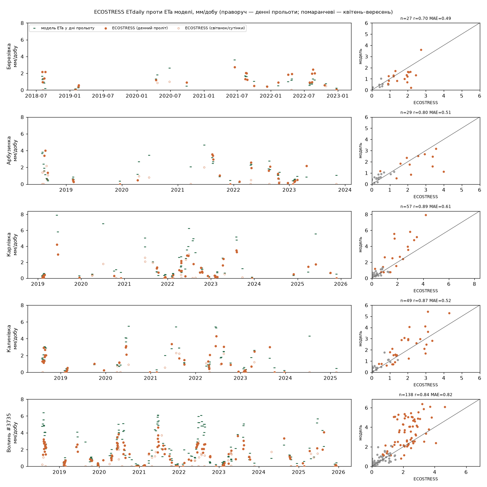

# ECOSTRESS (МКС) проти ETa моделі — 5 пілотних полів

_Згенеровано `python scripts/ecostress_compare.py`. Нічого не калібрували під ECOSTRESS._

## Дані

- **ECOSTRESS:** ECO_L3T_JET.002, шар `ETdaily` (70 м; медіана 4 моделей ET — PT-JPL-SM, STIC, MOD16, BESS — апскейл до денного ET від сходу до заходу сонця, мм/добу; ECOSTRESS Collection 2 Tiled User Guide, розд. 5.4). Хмари — ECO_L2T_LSTE.002 `cloud` (=1 відкинуто). Поле × дата — медіана 5 точок HLS усередині поля (`appeears_ecostress.py process`).
- **Модель:** денне ETa симулятора (FAO-56, той самий, що в оптимізаторі; календар D17), погода POWER того ж року, культура з HLS цього поля: W → пшениця озима, S late → кукурудза, S early → соняшник; «?» і S без підтипу — пропуск. Після збирання — голий ґрунт (Annex 7). Модель — ET за добу, ECOSTRESS — від сходу до заходу (нічне ET мале).

## 1. Нулі в ETdaily: не заповнення, але й не «ET голого поля»

- 1031 з 5437 значень точок (19 %) = 0,0; від'ємних і NaN немає.
- **Fill value ETdaily = NaN, не 0**: AppEEARS `/api/product/ECO_L3T_JET.002` (FillValue NaN, ValidMin/ValidMax порожні) і каталог Earthdata ECO_L3T_JET v002 («Daily Evapotranspiration (ET) estimate, Fill Value = NaN»). User Guide нуля як коду не описує. Отже 0 — валідне значення продукту → **повернуто** (`process`: фільтр `> 0` → `≥ 0`).
- Звідки нулі (дані, не документація): у квітні–вересні при прольоті 08:00–17:00 місцевого сонячного часу нулів 0–2 %, до 08:00 і після 17:00 — 13–57 %; узимку нулі в будь-яку годину (листопад 88 %, січень 69 %). ETdaily — апскейл миттєвого ET з моменту прольоту на світловий день, тож проліт на світанку/в сутінках дає ≈0 незалежно від поля. Це артефакт часу прольоту МКС, а не реальне ET голого поля.
- Тому нулі лишаються в `pilots_et_daily.csv`, додано `solar_hour` і `daytime` (08–17 сонячного часу); **порівняння з моделлю — лише денні прольоти** (300 з 397 пар поле×дата). Для повноти — усі прольоти: n 397, r 0.67, різниця +0.67, MAE 0.92 мм/добу.
- Дублікати тайлів (той самий проліт у двох тайлах MGRS) об'єднано медіаною.

## 2. Модель проти ECOSTRESS (денні прольоти, увесь рік)

| Поле | n | r (Пірсон) | ECOSTRESS, мм/добу | модель ETa, мм/добу | середня різниця (модель − ECO) | MAE |
|---|---|---|---|---|---|---|
| Березівка | 27 | 0.70 | 1.25 | 0.96 | -0.29 | 0.49 |
| Арбузинка | 29 | 0.80 | 1.24 | 1.10 | -0.15 | 0.51 |
| Карлівка | 57 | 0.89 | 0.86 | 1.34 | +0.48 | 0.61 |
| Калинівка | 49 | 0.87 | 1.27 | 1.53 | +0.26 | 0.52 |
| Волинь #3735 | 138 | 0.84 | 1.35 | 2.00 | +0.65 | 0.82 |
| **усі поля** | 300 | 0.81 | 1.23 | 1.62 | +0.39 | 0.67 |

## 3. Сезон квітень–вересень (денні прольоти)

| Поле | n | r (Пірсон) | ECOSTRESS, мм/добу | модель ETa, мм/добу | середня різниця (модель − ECO) | MAE |
|---|---|---|---|---|---|---|
| Березівка | 18 | 0.51 | 1.68 | 1.24 | -0.44 | 0.62 |
| Арбузинка | 12 | 0.43 | 2.46 | 1.82 | -0.64 | 0.86 |
| Карлівка | 18 | 0.80 | 2.03 | 3.22 | +1.20 | 1.34 |
| Калинівка | 28 | 0.77 | 1.98 | 2.30 | +0.32 | 0.72 |
| Волинь #3735 | 68 | 0.51 | 2.31 | 3.47 | +1.16 | 1.35 |
| **усі поля** | 144 | 0.60 | 2.14 | 2.79 | +0.65 | 1.10 |

За культурою (квітень–вересень):

| Культура | n | r | ECOSTRESS | модель | різниця | MAE |
|---|---|---|---|---|---|---|
| кукурудза | 67 | 0.32 | 2.30 | 3.13 | +0.84 | 1.32 |
| соняшник | 37 | 0.74 | 1.98 | 2.30 | +0.32 | 0.90 |
| пшениця озима | 40 | 0.78 | 2.04 | 2.69 | +0.64 | 0.90 |

За місяцем (усі поля, денні прольоти):

| Місяць | n | ECOSTRESS | модель | різниця |
|---|---|---|---|---|
| 01 | 5 | 0.10 | 0.35 | +0.25 |
| 02 | 70 | 0.23 | 0.42 | +0.19 |
| 03 | 5 | 0.97 | 1.25 | +0.28 |
| 04 | 31 | 1.42 | 1.43 | +0.01 |
| 05 | 1 | 0.25 | 1.16 | +0.91 |
| 06 | 39 | 2.75 | 4.02 | +1.27 |
| 07 | 2 | 1.55 | 3.56 | +2.01 |
| 08 | 66 | 2.22 | 2.81 | +0.59 |
| 09 | 5 | 1.45 | 1.45 | -0.00 |
| 10 | 39 | 0.88 | 0.93 | +0.05 |
| 11 | 3 | 0.17 | 0.36 | +0.19 |
| 12 | 34 | 0.08 | 0.24 | +0.17 |

## Висновок

Денні прольоти, увесь рік: r = 0.81, модель − ECOSTRESS = +0.39 мм/добу, MAE 0.67. Квітень–вересень: r = 0.60, різниця +0.65, MAE 1.10 мм/добу. **Модель розходиться з ECOSTRESS** за орієнтирами r ≥ 0.5, |різниця| ≤ 0.5, MAE ≤ 1.0 мм/добу (орієнтири, зафіксовані до розрахунку). Різниця за культурою (квіт–вер, модель − ECO): кукурудза +0.84, соняшник +0.32, пшениця озима +0.64. Не підганяли: Kc, фази, ґрунт і погода — як в оптимізаторі.

## Що не порівнювали

- Березівка 2023: HLS «S» — культуру не визначено, 10 прольотів
- Карлівка 2018: HLS «S» — культуру не визначено, 23 прольотів
- Карлівка 2026: немає погоди POWER у моделі (2001–2025) — 3 прольотів
- Волинь #3735 2026: немає погоди POWER у моделі (2001–2025) — 11 прольотів

## Обмеження

- Погода моделі — клітинка POWER ~50 км, ECOSTRESS — піксель 70 м: локальні дощі не збігаються день у день.
- Культура — з класу HLS (W / S early / S late), не підтверджена фермером; сорт, дата сівби, густота — модельні.
- ETdaily ECOSTRESS — теж модель (ансамбль 4 алгоритмів), не вимір; розкид між ними (ETinstUncertainty) — медіанно ~36 Вт/м².
- Після збирання модель вважає поле голим до 31.07 наступного року; восени на полі може бути наступна озима.
